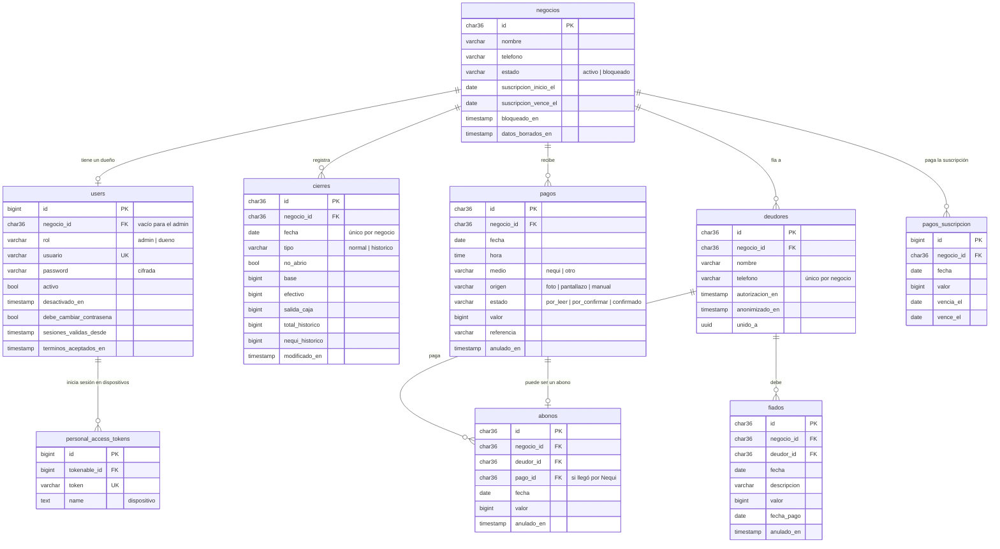

# Modelo de base de datos: Cierre de Caja

Base de datos **MySQL 8** (`utf8mb4_unicode_ci`) llamada `cierre_caja`. El modelo sale de las migraciones de Laravel (`api/database/migrations`); el script equivalente está en [`cierre_caja.sql`](cierre_caja.sql) y se probó importándolo en MySQL 8.4.3.

Los códigos RF-, RNF- y RN- remiten al documento de requerimientos v2.4.

## Diagrama



## Convenciones

- **Pesos enteros:** todos los valores de plata son `bigint unsigned` en pesos colombianos, sin decimales ni negativos (RN-06).
- **Identificadores:**
  - Las tablas que se llenan desde el celular (`cierres`, `pagos`, `deudores`, `fiados`, `abonos`) usan `char(36)` con un UUID que **genera el dispositivo**, para poder guardar sin internet (RF-30).
  - `negocios` también usa UUID.
  - `users` usa un número autoincremental.
- **Separación por negocio:** toda tabla del negocio tiene `negocio_id`. La API filtra sola por el negocio del dueño que inició sesión (RNF-08, RN-10).
- **Hora de Colombia:** las fechas y horas se guardan en la hora de Colombia (`APP_TIMEZONE=America/Bogota`, RNF-13).
- **Nada se borra:**
  - Los pagos, fiados y abonos equivocados se anulan con `anulado_en` y `motivo_anulacion` (RN-36).
  - Los datos de un deudor que pide que lo borren se vacían y se marca `anonimizado_en` (RN-42).
- **Versión para sincronizar:** `updated_at` funciona como la versión de cada registro. Si un cierre cambió en otro dispositivo, el servidor no lo sobrescribe (RNF-12).

## Tablas

### negocios
Cada negocio suscrito.

| Columna | Tipo | Nulo | Descripción |
|---|---|---|---|
| `id` | char(36) | No | UUID del negocio |
| `nombre` | varchar(255) | No | Nombre del negocio (RF-04) |
| `telefono` | varchar(20) | Sí | Teléfono del negocio |
| `estado` | varchar(20) | No | `activo` o `bloqueado`; bloqueado solo deja consultar (RF-12, RN-13) |
| `suscripcion_inicio_el` | date | Sí | Día del primer pago: desde cuándo es cliente (RF-08) |
| `suscripcion_vence_el` | date | Sí | Vencimiento de la suscripción (RF-08, RN-12). "Por vencer" cuando faltan 5 días o menos |
| `bloqueado_en` | timestamp | Sí | Cuándo lo bloqueó el admin; cuenta para el borrado de RN-34 |
| `datos_borrados_en` | timestamp | Sí | Cuándo se borraron sus datos por 6 meses sin servicio (RN-34) |
| `created_at`, `updated_at` | timestamp | Sí | Fechas de creación y modificación |

### users
El admin y los dueños.

| Columna | Tipo | Nulo | Descripción |
|---|---|---|---|
| `id` | bigint | No | Autoincremental |
| `negocio_id` | char(36) | Sí | Negocio del dueño. **Único**: un dueño, un negocio (RN-09). Vacío para el admin |
| `rol` | varchar(10) | No | `admin` o `dueno` |
| `nombre` | varchar(255) | No | Nombre de la persona |
| `usuario` | varchar(50) | No | Usuario para entrar. **Único** (RF-01) |
| `telefono` | varchar(20) | Sí | Teléfono del dueño |
| `password` | varchar(255) | No | Contraseña cifrada con bcrypt (RNF-09) |
| `activo` | tinyint(1) | No | 0 = desactivado; no puede entrar (RN-16) |
| `desactivado_en` | timestamp | Sí | Cuándo se desactivó; a los 6 meses se borran sus datos (RN-16, RN-34) |
| `debe_cambiar_contrasena` | tinyint(1) | No | 1 = contraseña temporal del admin; debe cambiarla al entrar (RF-46) |
| `sesiones_validas_desde` | timestamp | Sí | Al cambiar o restablecer la contraseña, las sesiones abiertas antes se cierran cuando sincronicen, después de enviar lo pendiente (RF-46, RF-47) |
| `terminos_aceptados_en` | timestamp | Sí | Cuándo aceptó los términos; vacío = no puede usar el sistema (RF-03, RN-15, RNF-10) |
| `remember_token` | varchar(100) | Sí | Interno de Laravel |
| `created_at`, `updated_at` | timestamp | Sí | |

### pagos_suscripcion
Historial de pagos mensuales de cada negocio (RF-09). Los registra el admin.

| Columna | Tipo | Nulo | Descripción |
|---|---|---|---|
| `id` | bigint | No | Autoincremental |
| `negocio_id` | char(36) | No | Negocio que pagó |
| `fecha` | date | No | Día en que pagó |
| `valor` | bigint | No | Pesos pagados (el precio todavía no es fijo, sección 7.1) |
| `vencia_el` | date | Sí | Vencimiento antes del pago |
| `vence_el` | date | No | Vencimiento nuevo: un mes desde `vencia_el` si estaba al día, o desde `fecha` si ya había vencido (RN-12) |
| `nota` | varchar(255) | Sí | Nota del admin (por ejemplo, "Pagó por Nequi") |
| `registrado_por` | bigint | Sí | Admin que lo registró |
| `created_at`, `updated_at` | timestamp | Sí | |

### personal_access_tokens
Una fila por cada dispositivo con la sesión abierta (Sanctum). `name` guarda el tipo de dispositivo y `token` la huella del token. Cerrar sesión borra la fila (RF-02).

### cierres
Un cierre por día y negocio.

| Columna | Tipo | Nulo | Descripción |
|---|---|---|---|
| `id` | char(36) | No | UUID generado en el celular |
| `negocio_id` | char(36) | No | Negocio |
| `fecha` | date | No | Día del cierre. **Único con `negocio_id`** (RN-01); no puede ser futuro (RN-07) |
| `tipo` | varchar(10) | No | `normal` o `historico`, cargado del cuaderno o de Excel (RN-35) |
| `no_abrio` | tinyint(1) | No | 1 = el negocio no abrió ese día (RN-31) |
| `base` | bigint | Sí | Base inicial |
| `efectivo` | bigint | Sí | Efectivo contado al final del día |
| `salida_caja` | bigint | No | Plata que sacó de la caja (RN-38); 0 por defecto |
| `total_historico` | bigint | Sí | Total de un cierre histórico (RN-35) |
| `nequi_historico` | bigint | Sí | Parte por Nequi de un cierre histórico, si se conoce |
| `modificado_en` | timestamp | Sí | Cuándo se corrigió o cambió por un pago tardío (RF-20, RN-30) |
| `created_at`, `updated_at` | timestamp | Sí | `updated_at` es la versión para sincronizar |

Lo vendido en efectivo **no se guarda, se calcula**: efectivo + salida_caja − base (RN-02). El total del día es lo vendido en efectivo más los pagos confirmados y no anulados de esa fecha (RN-03).

### pagos
Pagos digitales: Nequi y otros pagos (Daviplata, banco o tarjeta).

| Columna | Tipo | Nulo | Descripción |
|---|---|---|---|
| `id` | char(36) | No | UUID generado en el celular |
| `negocio_id` | char(36) | No | Negocio |
| `fecha` | date | No | Día al que pertenece: el del comprobante (RN-04) |
| `hora` | time | Sí | Hora del pago |
| `medio` | varchar(10) | No | `nequi` u `otro` (RNF-14) |
| `origen` | varchar(12) | No | `foto`, `pantallazo` o `manual` (RF-17, RF-51) |
| `estado` | varchar(12) | No | `por_leer` (foto sin internet), `por_confirmar` o `confirmado`. Solo suman los confirmados (RN-04) |
| `valor` | bigint | Sí | Vacío mientras la foto no se ha leído |
| `nombre_pagador` | varchar(255) | Sí | Nombre leído del comprobante (sugiere si es abono, RN-39) |
| `referencia` | varchar(40) | Sí | Para no cargar dos veces el mismo comprobante (RN-05); la API no cuenta los anulados |
| `foto_ruta` | varchar(255) | Sí | Foto del comprobante en el servidor |
| `foto_borrar_el` | date | Sí | La foto se borra en esta fecha: 90 días (RN-43) |
| `anulado_en`, `motivo_anulacion` | timestamp, varchar(255) | Sí | Anulación con motivo (RN-36) |
| `created_at`, `updated_at` | timestamp | Sí | |

Índices: (`negocio_id`, `fecha`) y (`negocio_id`, `referencia`).

### deudores
Clientes a los que se les fía.

| Columna | Tipo | Nulo | Descripción |
|---|---|---|---|
| `id` | char(36) | No | UUID generado en el celular |
| `negocio_id` | char(36) | No | Negocio |
| `nombre` | varchar(255) | Sí | Vacío si se anonimizó (RN-42) |
| `telefono` | varchar(20) | Sí | **Único con `negocio_id`** (RN-32) |
| `autorizacion_en` | timestamp | Sí | Cuándo aceptó el aviso de privacidad (RN-41) |
| `anonimizado_en` | timestamp | Sí | Cuándo se borraron sus datos a su pedido (RF-53, RN-42) |
| `unido_a` | uuid | Sí | Si dos celulares crearon sin internet a la misma persona (mismo teléfono), el repetido queda vacío y apunta al deudor que se conserva; sus fiados y abonos pasan a ese (RN-32) |
| `created_at`, `updated_at` | timestamp | Sí | |

El saldo **no se guarda, se calcula**: suma de los fiados menos suma de los abonos, sin contar los anulados (RN-17). El estado (pendiente, abonó, vencido, pagado) también se calcula (RN-37).

### fiados

| Columna | Tipo | Nulo | Descripción |
|---|---|---|---|
| `id` | char(36) | No | UUID generado en el celular |
| `negocio_id`, `deudor_id` | char(36) | No | Negocio y deudor |
| `fecha` | date | No | Día en que se fió |
| `descripcion` | varchar(255) | No | Qué se llevó |
| `valor` | bigint | No | Valor fiado |
| `fecha_pago` | date | No | Cuándo se comprometió a pagar; no antes de `fecha` (RN-24) |
| `anulado_en`, `motivo_anulacion` | timestamp, varchar(255) | Sí | Anulación con motivo (RN-36) |
| `created_at`, `updated_at` | timestamp | Sí | |

### abonos

| Columna | Tipo | Nulo | Descripción |
|---|---|---|---|
| `id` | char(36) | No | UUID generado en el celular |
| `negocio_id`, `deudor_id` | char(36) | No | Negocio y deudor |
| `pago_id` | char(36) | Sí | Pago Nequi del que salió el abono (RN-39) |
| `fecha` | date | No | Día en que se recibió; aparece en el cierre de ese día (RF-43) |
| `valor` | bigint | No | No mayor que el saldo (RN-19) |
| `nota` | varchar(255) | Sí | Nota opcional |
| `anulado_en`, `motivo_anulacion` | timestamp, varchar(255) | Sí | Anulación con motivo (RN-36) |
| `created_at`, `updated_at` | timestamp | Sí | |

### Tablas internas de Laravel
`sessions`, `cache`, `cache_locks`, `jobs`, `job_batches`, `failed_jobs` y `migrations`. Las crea Laravel; el sistema las usa para la caché, la cola de tareas (por ejemplo, el OCR) y el control de migraciones.

## Relaciones (llaves foráneas)

| Tabla | Columna | Apunta a |
|---|---|---|
| `users` | `negocio_id` | `negocios.id` |
| `cierres`, `pagos`, `deudores`, `fiados`, `abonos` | `negocio_id` | `negocios.id` |
| `fiados`, `abonos` | `deudor_id` | `deudores.id` |
| `abonos` | `pago_id` | `pagos.id` |
| `pagos_suscripcion` | `negocio_id` | `negocios.id` |
| `pagos_suscripcion` | `registrado_por` | `users.id` |

## Base del celular

La app guarda una copia de `cierres` y `pagos` y de `deudores`, `fiados` y `abonos` en el celular, con IndexedDB (`app/src/db/index.ts`). Cada registro lleva además:
- `pendiente`: indica que falta enviarlo.
- `version`: el `updated_at` del servidor que el celular conoce.

## Cómo crear la base y conectarla

### Opción recomendada: que Laravel cree las tablas

1. Enciende MySQL en Laragon.
2. Crea la base vacía, desde HeidiSQL de Laragon o desde la consola:
   ```sql
   CREATE DATABASE cierre_caja CHARACTER SET utf8mb4 COLLATE utf8mb4_unicode_ci;
   ```
3. Revisa la conexión en `api/.env`:
   ```
   DB_CONNECTION=mysql
   DB_HOST=127.0.0.1
   DB_PORT=3306
   DB_DATABASE=cierre_caja
   DB_USERNAME=root
   DB_PASSWORD=
   ```
4. Crea las tablas, el admin y el negocio de prueba:
   ```bash
   cd api
   php artisan migrate --seed
   ```

### Alternativa: importar el script

1. Importa `docs/cierre_caja.sql` en HeidiSQL o en phpMyAdmin, o desde la consola:
   ```bash
   mysql -u root < docs/cierre_caja.sql
   ```
   Crea la base, las tablas y el registro de migraciones.
2. Crea el admin y el negocio de prueba:
   ```bash
   cd api
   php artisan db:seed
   ```

No mezcles las dos opciones sobre la misma base. Si importas el script, `php artisan migrate` responderá "Nothing to migrate", que es lo correcto.

Las cuentas que crea el seeder están en `api/.env`:
- El admin, en `ADMIN_USUARIO` y `ADMIN_CONTRASENA`.
- El dueño de prueba, en `PRUEBA_USUARIO` y `PRUEBA_CONTRASENA`.
